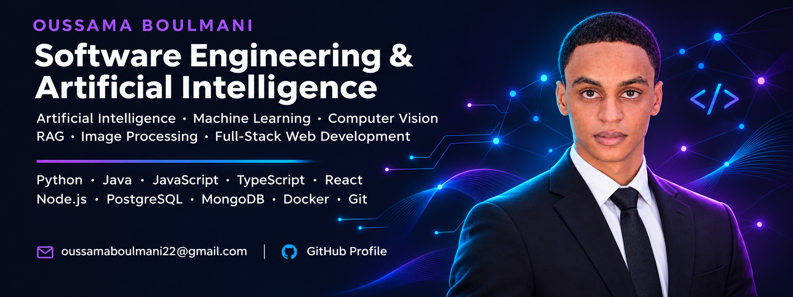
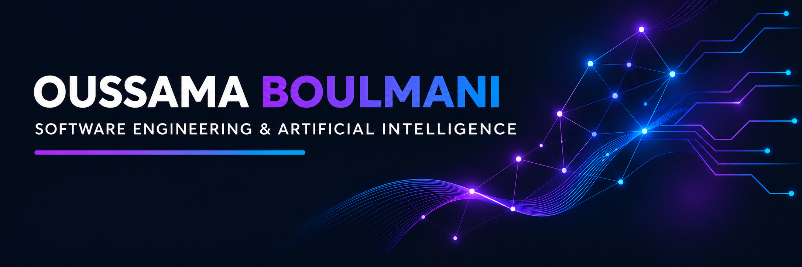
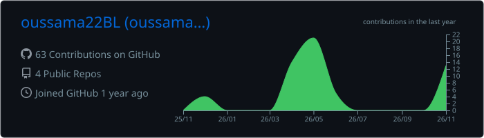
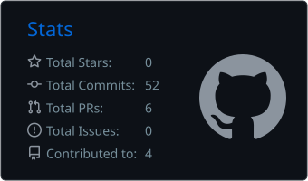
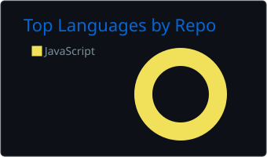
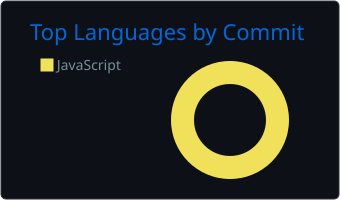
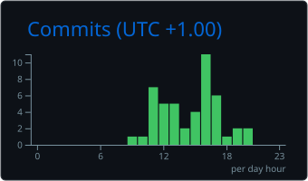
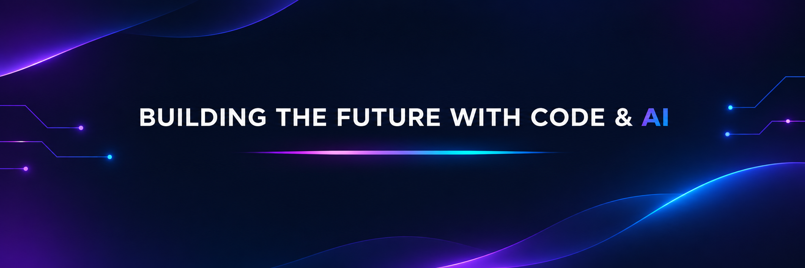

    

  <strong>SOFTWARE ENGINEERING · ARTIFICIAL INTELLIGENCE · FULL-STACK DEVELOPMENT</strong>
  

  
  

  
  
    

  <a href="#about">About</a>  • 
<a href="#projects">Projects</a>  • 
<a href="#experience">Experience</a>  • 
<a href="#stack">Tech Stack</a>  • 
<a href="#education">Education</a>  • 
<a href="#activity">Activity</a>  • 
<a href="#connect">Contact</a>

<!-- ======================================================== -->
<!-- 02 — ABOUT                                               -->
<!-- ======================================================== -->
01 / About Me
<!-- ABOUT IMAGE: Add your illustration as about.png. -->

  

I'm Oussama Boulmani, a Software Engineering and Artificial Intelligence engineering student at the Faculty of Sciences and Techniques (FST), Errachidia, Morocco.

I enjoy building practical software solutions and exploring how AI can improve real-world systems. My interests include Machine Learning, Deep Learning, Computer Vision, Graph Neural Networks (GNNs), RAG, and full-stack web development.
- 🎓 Education: Engineering Cycle in Software Engineering & AI (2024–2027)
- 🧠 AI interests: Machine Learning · CNN · GNN · Computer Vision · RAG
- 💻 Development: React · Next.js · Node.js · Express · TypeScript · Python
- 🎯 Current goal: 6-month PFE internship starting February 2027
- 📍 Location: Morocco

<!-- ======================================================== -->
<!-- 03 — PROJECTS                                            -->
<!-- ======================================================== -->
02 / Featured Projects
<table>
  <tr>
    <td width="50%" valign="top">
      <h3>🩻 Medical Anomaly Detection</h3>
      
<strong>Deep Learning · Medical Imaging · CNN + GNN</strong>

      
Developed an intelligent system to detect anomalies in chest X-ray images, including image preprocessing, feature extraction, a hybrid CNN–GNN architecture, and model evaluation.

      

        
        
        
      

    </td>
    <td width="50%" valign="top">
      <h3>📋 Taskme</h3>
      
<strong>Intelligent Audit Management Platform</strong>

      
Created an audit platform with expertise-based assignment scoring, JWT authentication, role-based access, instant notifications, collaborative chat, and task automation.

      

        
        
        
      

    </td>
  </tr>
  <tr>
    <td width="50%" valign="top">
      <h3>📦 Parcel Logistics Platform</h3>
      
<strong>Barid Al Maghrib · Full-Stack + Machine Learning</strong>

      
Built a parcel collection and shipping platform with client, commercial, and admin areas. Developed a <strong>Random Forest</strong> model to estimate delivery times using distance, weight, and network load.

      

        
        
        
      

    </td>
    <td width="50%" valign="top">
      <h3>🍽️ Assif n Toudgha Restaurant</h3>
      
<strong>Multilingual Restaurant Web Platform</strong>

      
Built a modern restaurant website with menus, gallery, contact details, and a reservation form. Designed responsive interfaces and multilingual support in <strong>French, English, and Spanish</strong>.

      

        
        
        
      

    </td>
  </tr>
</table>

  

<!-- ======================================================== -->
<!-- 04 — EXPERIENCE                                          -->
<!-- ======================================================== -->
03 / Professional Experience
💼 Full-Stack Development Intern (PFA) — Barid Al Maghrib
July – September 2026
- Designed and developed a parcel management platform with client, commercial, and administrative spaces.
- Implemented the full-stack solution with React, Node.js/Express, and PostgreSQL.
- Developed a Random Forest model to predict parcel delivery times.

<!-- ======================================================== -->
<!-- 05 — TECH STACK                                          -->
<!-- ======================================================== -->
04 / Technical Stack
Programming Languages

  

Web Development

  

AI, Machine Learning & Data

  

Machine Learning · Deep Learning · CNN · GNN / GraphSAGE · RAG · Image Processing · PyTorch Geometric · Pandas · NumPy
Databases & Tools

  

REST APIs · JWT Authentication · Socket.io · Jira

<!-- ======================================================== -->
<!-- 06 — EDUCATION & COMMUNITY                               -->
<!-- ======================================================== -->
05 / Education & Community
Period	Qualification	Institution
2024–2027	Engineering Cycle — Software Engineering & AI	FST Errachidia
2021–2024	DEUST — Mathematics, Computer Science & Physics	FST Errachidia
2020–2021	Baccalaureate — Physical Sciences	Lycée Ibrahim ibn alidham, Tinghir

Activities
- ARTWARE Club: Vice media; participation in club activities.
- Hult Prize: Participated in an international innovation and entrepreneurship competition.
- Game of Code — INSIAS Rabat: Solved algorithmic problems as part of a team under time constraints.

<!-- ======================================================== -->
<!-- 07 — GITHUB ACTIVITY                                     -->
<!-- The five SVG files below are generated by GitHub Actions. -->
<!-- ======================================================== -->
06 / GitHub Activity

  <strong>CODE · CONTRIBUTE · LEARN · BUILD</strong>
  

  <!-- Contribution overview -->
    

  <!-- GitHub statistics and repository languages -->
  
    

  <!-- Languages by commits and productive coding time -->
  
    

  Activity cards are generated automatically using the included GitHub Actions workflow.
  

  

<!-- ======================================================== -->
<!-- 08 — CONTACT                                             -->
<!-- ======================================================== -->
07 / Let's Connect

  
<strong>Interested in Software Engineering, Artificial Intelligence, or collaboration?</strong>
  
I'm open to a <strong>6-month PFE internship starting February 2027</strong>.
  

  
    

  
<strong>Arabic:</strong> Native &nbsp;·&nbsp; <strong>French:</strong> Fluent &nbsp;·&nbsp; <strong>English:</strong> Intermediate
  

  <!-- ====================================================== -->
  <!-- 09 — FOOTER IMAGE                                      -->
  <!-- Add your custom bottom banner as footer.png.           -->
  <!-- ====================================================== -->
  

